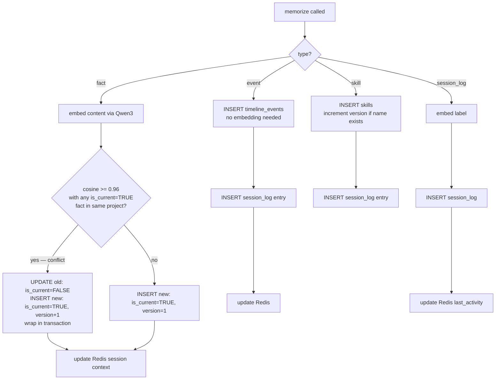

# CLAUDE.md — MLMS

MLMS is a self-hosted MCP server giving LLM agents persistent cross-session memory across 4 CoALA layers.

---

## Behavioral Rules

1. **Don't assume** — ambiguous intent gets a question, not a guess. Never silently pick an interpretation.
2. **Minimum code** — solve only what was asked. No speculative features, no single-use abstractions. If 50 lines works, don't write 200.
3. **Surgical changes** — touch only what the task requires. Don't refactor adjacent code, don't "improve" comments. Unrelated dead code gets flagged, not deleted.
4. **Goal-driven loops** — when given success criteria, verify them before stopping. Don't report done until tests pass.
5. **Verify, don't trust** — re-check any claim (agent report, "already fixed", assumed state) against live state before acting on it. "Fixed earlier this session" is never sufficient — verify fresh, every time.
6. **No irreversible action without a fresh yes** — commit, push, force-push, history-rewrite: explicit per-instance approval required, even for a verified fix, even if a similar action was approved minutes ago. Approval doesn't carry forward to the next instance of the same action.

---

## Key Constants — never change without explicit instruction

```python
EMBEDDING_DIM            = 1536       # Matryoshka truncation of Qwen3-Embedding-8B (4096→1536), pgvector HNSW limit is 2000
EMBEDDING_MODEL          = "qwen3-embedding-8b"
EMBEDDING_FALLBACK       = "qwen3-embedding-0.6b"

COSINE_CONFLICT_THRESHOLD = 0.96      # calibration needed

REDIS_SESSION_TTL        = 172800
REDIS_KEY_PATTERN        = "session:{chat_id}"

LATENCY_P99_TARGET_MS    = 200        # cached path only
LATENCY_SESSION_CTX_MS   = 5         # get_session_context() hard limit
PRECISION_AT_5_TARGET    = 0.80      # Recall@5 metric — renamed from precision@5, sparse ground truth (1-2 relevant per scenario)

MEMORY_CONTENT_MAX_LENGTH = 10_000            # memorize(content) hard reject limit — sized off the weaker fallback model's token limit, not the primary
MEMORY_CONTENT_RECOMMENDED_LENGTH = 500       # soft guidance, not enforced — atomic facts retrieve more precisely than long composite ones
```

---

## System Architecture

```mermaid
graph TD
  LLM[LLM Client] -->|MCP JSON-RPC only| Server[MCP Server + Business Logic]
  Server --> EmbAPI[Qwen3-Embedding-8B\nOpenRouter API]
  Server --> PG[(PostgreSQL\npgvector + TimescaleDB)]
  Server --> RD[(Redis)]

  PG --> F[facts\nSemantic Memory]
  PG --> TE[timeline_events\nEpisodic / project scale]
  PG --> SL[session_log\nEpisodic / chat scale]
  PG --> SK[skills\nProcedural Memory]
  RD --> SC[session:{chat_id}\nWorking Memory]
```

---

## memorize() Routing



---

## Implementation Order — respect architectural dependencies

Step 1 — `docker-compose.yml` (postgres with pgvector+timescaledb extensions, redis)
Step 2 — alembic migrations (5 tables + hypertables + HNSW indexes)
Step 3 — `embedding.py` (Qwen3 API + fallback + semantic cache)
Step 4 — `storage/facts.py` (conflict detection + is_current logic + ACID transaction)
Step 5 — `storage/timeline.py` (hypertable inserts + temporal range queries)
Step 6 — `storage/session_log.py` (in-session reads + cross-session cosine search)
Step 7 — `storage/session_ctx.py` (Redis hash + EXPIRE on every access)
Step 8 — `storage/skills.py` (versioning: increment version, never DELETE)
Step 9 — `tools/memorize.py` (routes to correct storage layer per type)
Step 10 — `tools/get_*.py` (6 read tools)
Step 11 — `tools/search_memory.py` (cross-layer search — needs all layers ready)
Step 12 — `server.py` (register all 7 tools, start MCP server)
Step 13 — `tests/` (unit + integration + 100-scenario benchmark)

---

## Anti-Patterns — things Claude gets wrong on this project

- Different embedding models on different tables — breaks cosine similarity (different vector spaces)
- Physical DELETE on facts — use `is_current=FALSE` (soft delete preserves version history)
- Conflict detection outside a transaction — race condition, must be atomic
- Treating `COSINE_CONFLICT_THRESHOLD = 0.96` as immutable — always note it needs calibration
- Hard-coding tool count, FR count, NFR count — anchors: 7 tools, 8 FR, 5 NFR
- Writing `ALTER TABLE` for new event metadata — use the existing `metadata JSONB` column
- Comparing vectors from different embedding model outputs — meaningless cosine values
- Over-commenting — write self-documenting code. Comments only for non-obvious WHY, never for WHAT. No docstrings on obvious functions. No "# Initialize the connection" above connection = connect(). Code should read like written by a developer, not explained to one.
- Using `vector(4096)` or `vector(2048)` for embeddings — EMBEDDING_DIM = 1536 (Matryoshka truncation of Qwen3-4096); HNSW limit in pgvector 0.8.x = 2000, so 1536 is the correct value

---

## Key Decisions Log

All non-obvious architectural decisions (index type changes, schema trade-offs, library limitations)
must be recorded in `KEY_DECISIONS.md` at the project root.
Format: date, decision, reason, alternatives rejected, affected files, trade-offs.

**Write the final state, not the process.** A decision entry records what was decided and why —
not a transcript of every attempt or false start that led there ("first thought it was X, then
it turned out to be Y, then testing surfaced Z"). If it took three tries to land the fix, the
entry says what the bug was, why it happened, and how it was fixed — not the sequence of who
found what. `KEY_DECISIONS.md` shows how the project thinks and what got fixed, not a log of how
the work went.

**The private working notes file is local-only — never committed, never public.** Any file that
IS committed/public (`KEY_DECISIONS.md`, `docs/known-issues.md`, `README.md`, code comments, commit
messages) must never reference it by name or point a reader at it. If a point from it
needs to survive into a public doc, restate the substance inline instead of citing the file — a
committed doc pointing at a file that doesn't exist in the clone is broken for anyone reading it.

---

## Directory Layout

```
mlms/
├── CLAUDE.md
├── docker-compose.yml
├── pyproject.toml
├── alembic/versions/          001–005 migrations
├── src/mlms/
│   ├── server.py              MCP entry point, 7 tools registered
│   ├── config.py              all constants above
│   ├── embedding.py           API + fallback + cache
│   ├── storage/               facts, timeline, session_log, session_ctx, skills
│   └── tools/                 memorize, get_facts, get_timeline, get_session_log,
│                              get_session_context, get_skills, search_memory
├── tests/unit/ integration/ fixtures/synthetic_100.json
└── scripts/seed_test_data.py
```
